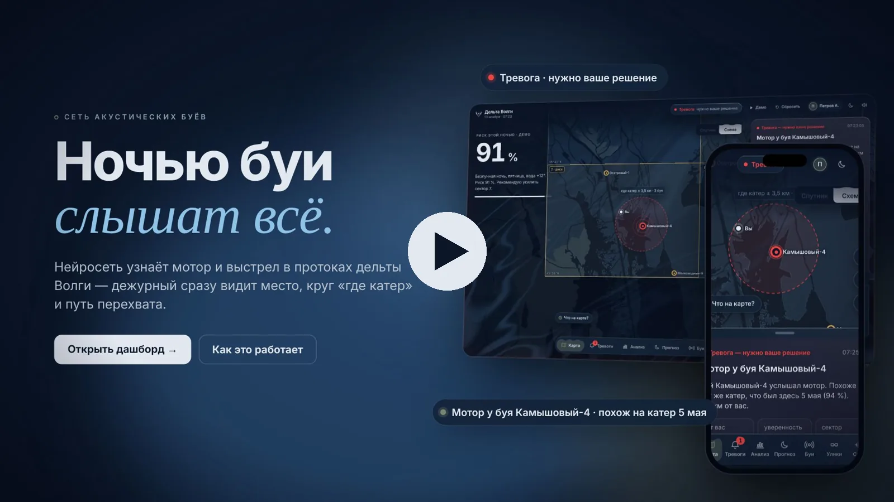
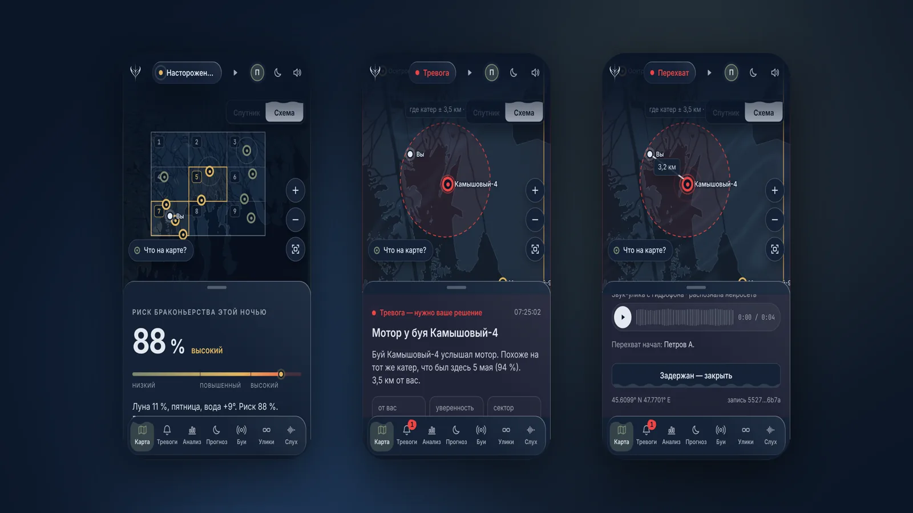
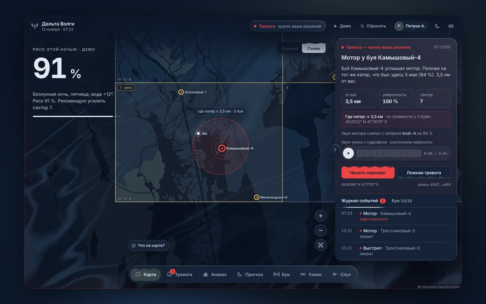
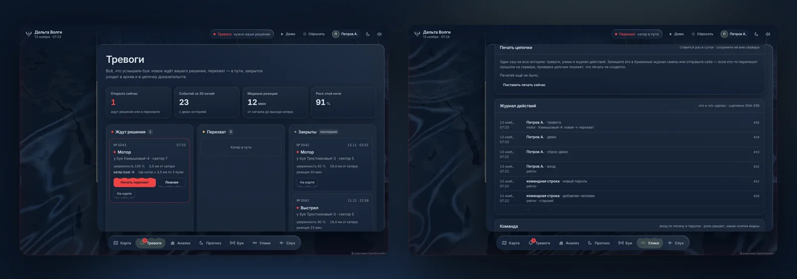
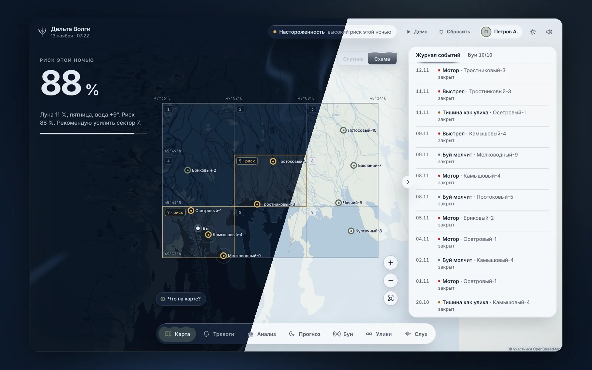
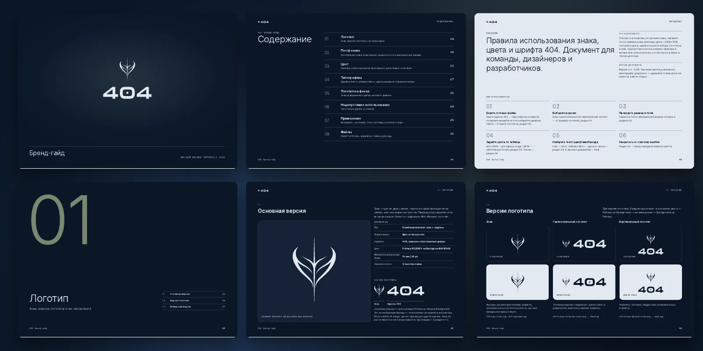

<h1 align="center">404 · Браконьер не найден</h1>

  Буи с гидрофонами слушают воду в дельте Волги. Нейросеть узнаёт мотор катера, выстрел и подозрительную тишину. 
  Инспектор сразу видит на карте, где это было, и получает звук как улику.

  <a href="https://vkvideo.ru/video-242996997_456239018?list=ln-DMKbO6lyNoDqjp7KRL"><b>Видеопрезентация</b></a> ·
  <a href="https://codespaces.new/404-hak/404?quickstart=1"><b>Запустить в Codespaces</b></a> ·
  <a href="brand/404-brandbook.pdf"><b>Брендбук</b></a> ·
  <a href="docs/technical.md"><b>Техническое описание</b></a>

## Видеопрезентация

## Зачем это заповеднику

Браконьеры в дельте выходят ночью: на катере по протокам и в камышах, без огней. Инспекторов мало, район большой, патруль не может быть везде сразу. Камера ночью и в камышах почти ничего не видит, поэтому о выходе часто узнают уже по следам.

Звук под водой идёт далеко и не зависит от света, тумана и камыша. Винт шумит всё время, пока катер идёт. Поэтому мы не смотрим, а слушаем: буи присылают короткие клипы с гидрофона, а система решает, ради чего стоит поднимать инспектора.

## Как это работает

1. **Буй слушает.** Каждые несколько секунд он присылает клип с гидрофона и пульс с зарядом батареи.
2. **Нейросеть разбирает звук.** Она различает фон, мотор, выстрел и голоса людей, отдельно оценивает, насколько живая природа вокруг (лягушки, птицы, насекомые), и снимает отпечаток мотора.
3. **Ухо буя решает, будить ли инспектора.** Мотор поднимает тревогу, только если его слышно два клипа подряд, выстрел проходит по строгому порогу. Голоса и непривычные звуки идут в журнал, а не в тревогу. Если природа у буя стихла, это тоже сигнал.
4. **Тревога.** На карте видны буй, круг «где катер» по громкости у соседних буёв, снимок места со спутника и звук-улика. Дежурному приходит сообщение в Telegram.
5. **Перехват.** Дежурный нажимает «Начать перехват», и маршрут ведёт в центр круга, а остальные видят, кто взял тревогу. Закрывая её, он отмечает, задержан катер или тревога ложная.
6. **Улика.** Звук и запись тревоги связаны цепочкой SHA-256: подмена одного байта видна при проверке.

### Дашборд

- **Обстановка:** карта района, журнал, тревога и риск этой ночи.
- **Тревоги:** доска «ждут решения → перехват → закрытые», действия прямо из карточки.
- **Доказательства:** проверка цепочки, звук-улика и журнал действий людей.
- **Прогноз:** риск на 14 ночей вперёд и из чего он складывается.
- **Статистика:** совпадает ли прогноз с тем, что слышат буи; сектора и часы ночи.
- **Буи:** связь, заряд, «здоровье».
- **Нейросеть («Слух»):** лаборатория, где видно всё, что слышит и решает сеть. Её можно проверить своим голосом.

## Чем подход отличается

### Тишина как улика

Браконьер может заглушить мотор и идти на вёслах. Мотора не слышно, но рядом с человеком смолкают лягушки и птицы. Система знает, насколько обычно живая природа у каждого буя, и поднимает тревогу, если три клипа подряд она ниже 40 % обычного. Так ловится то, чего не услышит детектор, настроенный только на громкие звуки.

### Отпечаток катера

Из звука мотора сеть снимает отпечаток: 32 числа и ритм шума винта. Ритм считается методом DEMON из подводной акустики: частоты вала и лопастей постоянны для катера и почти не зависят от отражений на мелководье. По отпечатку система пишет: «похоже на тот же катер, что был здесь 5 мая».

Порог выбран осторожный: чужой катер выдаётся за знакомый не чаще чем в ~1 % сверок. Поэтому по одному проходу катер узнаётся примерно в половине случаев, а остальные система честно называет новыми. Это улика «тот же звук мотора», а не номер катера.

### «Где катер» по громкости

Один катер слышат несколько буёв, и ближний слышит громче. На мелководье звук слабеет примерно на 15·log10(расстояния) дБ, поэтому разница громкости даёт отношение расстояний, а из него получается круг, куда идти. Тревога при этом остаётся одна, а не по одной на каждый буй. Круг служит подсказкой, а не уликой, и в хэш не входит.

### Голоса не поднимают тревогу

Мимо проходят люди, рядом разговаривают сами инспекторы. Если поднимать тревогу на каждый голос, на тревоги перестанут реагировать. Поэтому сеть отдельно учится узнавать речь, крик, смех и звуки ртом («бах», «бррр»), чтобы не путать их с выстрелом и мотором. По той же причине мотору нужны два клипа подряд, а звук, не похожий ни на что из обучения, помечается как «непривычный» и тревогу не поднимает.

### Прогноз ночи

Браконьеры выходят не наугад: чаще в безлунные ночи, в выходные, при подходящей воде. Риск считается по настоящему лунному календарю, дню недели, температуре воды и ветру (Open-Meteo). Это объяснимая формула, а не нейросеть, и каждое слагаемое видно в интерфейсе: «Безлунная ночь, пятница, вода +12°». Учить модель риска на нашей демо-истории нельзя, потому что история сгенерирована той же формулой. Для обучения нужна настоящая история выходов.

## Почему мы сделали так

### Почему улика устроена цепочкой

Тревога ценна, только если её можно предъявить. Каждый клип хранится в том виде, в каком пришёл, под своим SHA-256. Этот хэш входит в хэш тревоги, а хэш тревоги входит в следующий. Проверка сверяет и записи, и звук.

Действия людей (кто взял тревогу, кто закрыл и с каким итогом) записываются в отдельный журнал той же цепочкой. Раз в сутки цепочке ставится печать, которую можно отправить наружу, и тогда задним числом не переписать даже всю базу. Итог инспектора и круг «где катер» в хэш тревоги не входят: это обработка, а не улика.

### Почему нейросеть учили на синтезе

Записей с гидрофонов заповедника пока нет, а ролики из интернета записаны в воздухе и чужими микрофонами. Поэтому мы сделали синтез по физике источников. У каждого катера свои цилиндры, винт и корпус. Звук из воздуха проходит в воду малой долей. На мелководье он отражается от поверхности и дна. 60 % обучения проходит под водой, 40 % в воздухе: так сеть можно проверить микрофоном ноутбука прямо на сайте.

Проверка честная. Отпечатки проверяются на 40 катерах, которых не было в обучении, потому что браконьер приходит со своим мотором. Пороги подобраны на отдельных клипах фона и голосов.

| На синтезе | Под водой (буй) | В воздухе (микрофон) |
|:--|:--|:--|
| Верных ответов | 97 % | 91 % |
| Мотор | 93 % при 1 % ложных на клип; с правилом двух клипов ложных ≈ 0,01 % | 73 % при 1 % ложных |
| Выстрел | 96 % при 0,1 % ложных | 62 %: хлопки в комнате слишком похожи |

На настоящей воде цифры будут другими. Конвейер дообучения на записях готов, а раздел «Слух» показывает, на чём сеть ошибается. Сети небольшие: учатся в scikit-learn, а на сервере работают на чистом numpy за миллисекунды, без видеокарты.

### Почему карта и есть интерфейс

Дежурному ночью нужен один ответ: где. Поэтому карта занимает весь экран, раздел открывается листом сбоку, а легенда свёрнута в кнопку. Новая тревога пускает волну от буя и сразу показывает снимок места со спутника. Ещё до выезда видно, что там: протока, камыш или открытая вода.

Без ключа Яндекс Карт или без интернета включается своя схема дельты из OpenStreetMap, поэтому ни показ, ни работа не ломаются.

### Почему вода и поплавок

Система слушает воду, и образ взят оттуда же. Знак 404 построен как поплавок, буй на карте выглядит так же, а нажатие и тревога расходятся кругами, как звук под водой и сигнал на экране сонара. На воде лежат изобаты, как на морской карте. Курсор мыши тоже поплавок: над кнопкой он «клюёт», а сами кнопки налиты водой. Так одна мысль проходит через все детали и не превращается в набор украшений.

### Почему тёмно и спокойно

Дежурят ночью, часто с телефона в катере. Тёмная тема не слепит и не сбивает глаза, привыкшие к темноте. Красный означает только тревогу, янтарь только повышенный риск, всё остальное приглушено: если ярко всё, тревогу не заметишь. Анимации медленные, звук выключается одной кнопкой. При системной настройке «уменьшить движение» и в экономном режиме живой фон замирает. Для дня есть светлая тема.

### Почему один сайт на всё

Сайт, приложение для iPhone и приложение для Windows и macOS работают на одном коде. Приложения — тонкие оболочки: они открывают сайт и добавляют своё, то есть уведомления о тревоге, микрофон и переподключение. Исправление на сайте сразу появляется везде, без пересборки и магазинов приложений.

### Почему звук людей не копится

Гидрофон у воды слышит и людей. Поэтому звук без тревоги удаляется через 24 часа, а речь без тревоги не сохраняется вовсе: в журнале остаётся только отметка «голоса». Звук тревог хранится, потому что это улика.

Войти можно по ссылке для дежурных или по учётной записи с ролью: наблюдатель смотрит, дежурный берёт и закрывает тревоги, старший управляет людьми. Подробности — в [политике конфиденциальности](docs/privacy-policy.md).

## Брендбук

В брендбуке 35 страниц: построение знака, версии логотипа, палитра с контрастом по WCAG, типографика и применение. Знак, логотипы и страницы собираются из одного файла геометрии, а цвета и шрифты попадают в код из общих токенов, поэтому сайт и брендбук не расходятся.

| Цвет | HEX | Роль |
|:--|:--|:--|
| Пенный | `#E2E8F0` | знак, надпись, основной текст |
| Ночной | `#0B1628` | основная поверхность |
| Глубинный | `#142236` | карточки и панели |
| Сланцевый | `#64748B` | вторичный текст, линии |
| Шалфейный | `#7A866F` | акценты, узлы сети, «норма» |
| Янтарный | `#F59E0B` | повышенный риск |
| Коралловый | `#EF4444` | тревога |

**[Брендбук в PDF](brand/404-brandbook.pdf)** · **[Пакет логотипов](brand/logo-package/404-logo-package.zip)**: 65 файлов в SVG, PDF и PNG, иконки и фавикон.

## Проработано до мелочей

**Свои элементы вместо браузерных.** Меню правой кнопки мыши предлагает действия для того, что под ней: у буя, тревоги, снимка, звука. Подсказки, плашка «куда ведёт ссылка», перетаскивание с пружиной и кругами, курсор ввода в виде иглы и проигрыватель звука-улики с настоящей формой волны тоже свои. На телефоне остаётся системное поведение, как привычно.

**Надёжность.** Связь с сервером восстанавливается сама. Демо работает в отдельной базе и не трогает настоящие данные. У каждого буя может быть свой токен, а буй, который молчит дольше минуты, даёт отдельную тревогу «нет связи».

**Проверено.** При каждом изменении в GitHub Actions запускаются 60 тестов API (доступ, роли, цепочка, буи стоят на воде), тесты интерфейса и сквозной сценарий дежурного в настоящем браузере. Разбор безопасности, приватности, скорости, SEO и архитектуры лежит в [docs/audit](docs/audit/README.md). Сборка для сервера — в `deploy/`: Docker, Caddy с HTTPS и резервная копия.

## Что настоящее, а что пока симуляция

| Часть | Сейчас |
|:--|:--|
| Распознавание звука, отпечатки, «где катер» | Настоящие нейросети и алгоритмы; обучены на синтезе, нужно дообучить на записях заповедника |
| Цепочка улик, журнал действий, печати | Настоящие |
| Луна и погода | Астрономический расчёт и Open-Meteo |
| Формула риска | Эвристика; нужно учить на настоящей истории выходов |
| Звук с буёв | Симулятор шлёт синтезированный звук через тот же API, что и настоящие буи |
| Координаты буёв | Демонстрационные, но на воде по OpenStreetMap; это проверяет тест |
| История событий | Сгенерирована за 60 ночей и помечена `synthetic` |

## Технологии

- **Сервер:** Python, FastAPI, numpy, SQLite.
- **Нейросети:** обучение в scikit-learn.
- **Интерфейс:** React, TypeScript, Vite, Tailwind, Leaflet, Яндекс Карты, WebGL.
- **Приложения:** Swift и WKWebView для iPhone и iPad, Electron для Windows и macOS.
- **Проверки:** pytest, Vitest, Playwright, GitHub Actions.

## Запуск

Через 1–2 минуты дашборд откроется сам; ключ Яндекс Карт не обязателен. Локально нужны Python 3.11+ и Node 18+: `bash scripts/start.sh` поднимет дашборд на http://localhost:8000. Сценарий тревоги запускает кнопка «▶ Демо» вверху экрана.

Приложения для iPhone, Windows и macOS, API, учётные записи и сервер описаны в [техническом описании](docs/technical.md).

## Статус проекта

Это демо для хакатона. Весь путь «звук → нейросеть → тревога → перехват → улика» работает на симуляторе буёв. Следующий шаг — записи с настоящих гидрофонов и дообучение на них.

<b>Команда 404</b>

